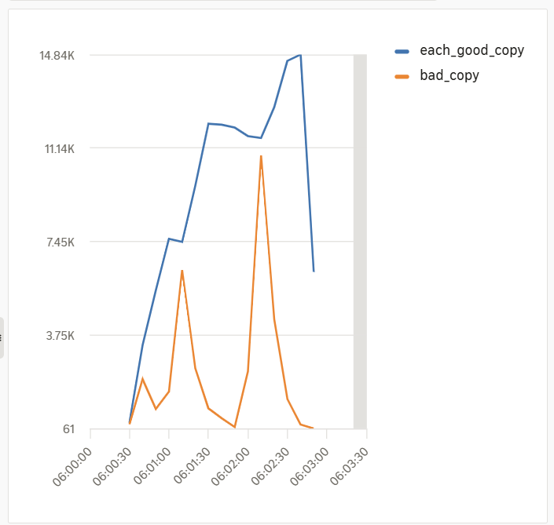
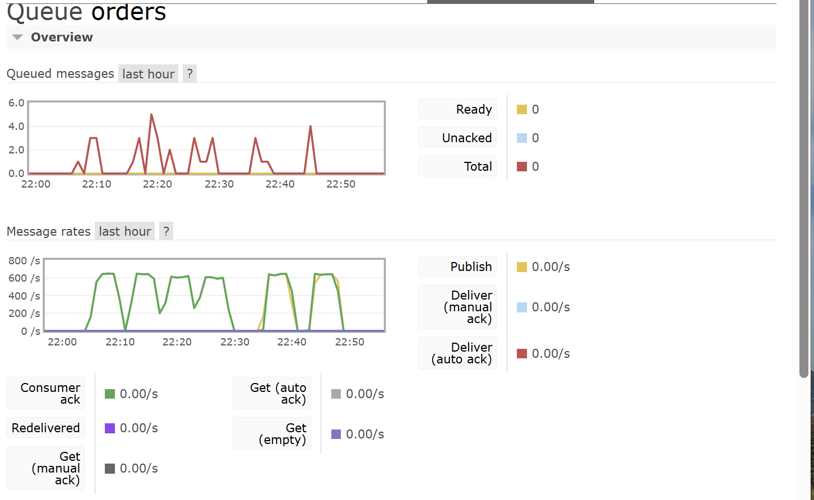

# sds-online-store

An online store split into microservices on AWS ECS.
A customer's checkout goes through an Application Load Balancer to the Shopping Cart service, which asks a mock Credit Card Authorizer and then sends the order to a Warehouse through RabbitMQ.

**Group members:** Aleksei Anisimov

## Results

All tests ran on AWS (us-west-2) with the load client inside AWS, against the ALB.

- **200,000 checkouts, 0 failed, 0 lost orders.** Best run: 704 req/s with 32 client threads. The Warehouse totals matched the authorized checkouts exactly in every run (719,930 orders over four runs, then 180,009 and 180,209).
- **RabbitMQ queue stayed flat and near zero:** at most 9 messages waiting, for every setup from 32 to 256 client threads and 1 to 16 Warehouse threads.
- **ATW moved traffic away from the failing instance.** One of three Product tasks returns 503 for half of the requests. Without ATW it would get about 33% of the traffic; with ATW it got 10.7% (each healthy task got 44.7%). Over 300,000 requests at 2,224 req/s the client saw 0 failed requests.

| Client threads | Warehouse threads | Throughput | Failed | Max queue |
|---|---|---|---|---|
| 32 | 16 | 695 req/s | 0 | 3 |
| 64 | 16 | 615 req/s | 0 | 3 |
| 128 | 16 | 674 req/s | 0 | 9 |
| 256 | 16 | 664 req/s | 0 | 7 |
| 32 | 4 | 704 req/s | 0 | 5 |
| 32 | 1 | 704 req/s | 0 | 3 |

More client threads did not help: the single Shopping Cart task is the limit, because every checkout waits for the card authorizer and for the RabbitMQ publisher confirm. One Warehouse thread is already enough at this rate.

| Requests per Product task (blue: each healthy task, orange: failing task) | RabbitMQ queue during all six runs |
|---|---|
|  |  |

## How a checkout works

```
client ──▶ ALB ──/shopping-cart*──▶ Shopping Cart ──(via ALB)──▶ Credit Card Authorizer
                                         │
                                         ▼  Publisher Confirms
                                     RabbitMQ  ──▶  Warehouse (N threads, manual acks)
```

1. `POST /shopping-carts/{id}/checkout` with a card number reaches the Shopping Cart through the ALB.
2. The cart calls `POST /credit-card-authorizer/authorize`, also through the ALB.
   The CCA answers `400` for a bad format, otherwise `200` (90%) or `402` declined (10%) at random.
3. If authorized, the cart publishes the order to the `orders` queue and waits for the publisher confirm before it answers `200 {"order_id": …}`.
4. The Warehouse counts the order (total orders and quantity per product) and only then acks the message.
   On shutdown it prints the total number of orders.

## Structure

| Folder | What it is |
|---|---|
| `product/` | Product service, `POST /product` → `201`. With `FAILURE_RATE=0.5` it is the "bad" copy that answers `503` half of the time. |
| `credit-card/` | Credit Card Authorizer mock: card syntax check, 90% authorized / 10% declined. |
| `shopping-cart/` | Create cart, add item, checkout. Calls the CCA and publishes orders to RabbitMQ with a pool of confirm channels (Apache Commons Pool). |
| `warehouse/` | Multithreaded RabbitMQ consumer with manual acks and thread-safe counters. |
| `load-client/` | Multithreaded load tester: `product` mode for the ATW test, `checkout` mode for 200,000 checkouts. |
| `terraform/` | ECR, ECS Fargate services, ALB with path-based routing and Automatic Target Weights, RabbitMQ behind an internal NLB. |
| `docker-compose.yml` | The whole store on one machine. |

All URL paths, request and response bodies follow `improved_api.yaml`.

## Requirements

Java 17+, Docker, AWS CLI with Learner Lab credentials, Terraform, Git Bash (for the `.sh` scripts on Windows).
Maven is not needed: every Java project has its own `mvnw` wrapper.

## Run locally

```
docker compose up --build
```

| Port | Service |
|---|---|
| 8080 | Product |
| 8090 | Bad Product |
| 8081 | Shopping Cart |
| 8082 | Credit Card Authorizer |
| 15672 | RabbitMQ console (guest / guest) |

A full purchase:

```
curl -X POST localhost:8081/shopping-cart -H "Content-Type: application/json" -d '{"customer_id":5}'
curl -X POST localhost:8081/shopping-carts/1/addItem -H "Content-Type: application/json" -d '{"product_id":42,"quantity":3}'
curl -X POST localhost:8081/shopping-carts/1/checkout -H "Content-Type: application/json" -d '{"credit_card_number":"1234-5678-9012-3456"}'
```

Expected: `{"shopping_cart_id":1}`, then `204`, then `{"order_id":1}` (or `402` when the card is declined).
`docker compose logs warehouse` shows `orders so far: 1`.

## Deploy to AWS

Region `us-west-2`. First create the image repositories, push the images, then create everything else:

```
cd terraform
terraform init
terraform apply -target="aws_ecr_repository.app"

cd ..
./push-images.sh

cd terraform
terraform apply
```

`terraform apply` prints `alb_url`: the only address clients use.
RabbitMQ runs behind an internal Network Load Balancer because Learner Lab does not allow Cloud Map service discovery.

Settings (in `variables.tf`, change with `-var`): number of good / bad Product tasks (2 / 1), Shopping Cart and CCA tasks (1 / 1), `warehouse_threads` (16), `cart_channel_pool_size` (32).

After a code change, push only that image and restart its service:

```
./push-images.sh shopping-cart
aws ecs update-service --cluster online-store-cluster --service shopping-cart --force-new-deployment --region us-west-2
```

## Load tests

The load client runs inside AWS as a one-off ECS task against the ALB and prints its result at the end:

```
./run-load-test.sh product 64 300000      # ATW test
./run-load-test.sh checkout 32 200000     # 200,000 checkouts
```

Arguments: mode, client threads, number of requests.
The test creates one cart with one item and then checks it out 200,000 times.
Declined cards (`402`) are normal answers and are counted as successful requests, shown separately.

## Delete everything from AWS

```
cd terraform
terraform destroy
```

Type `yes` when asked.
